# MNIST Autoencoder Study

> **Disclaimer:** This project was developed as a learning and research exercise to better understand neural network representations and autoencoder architectures. Feel free to use or modify the code.

## Introduction

This study explores optimal hyperparameter and architectural configurations for various Autoencoder (AE) models trained on the MNIST dataset. To increase difficulty and test model robustness, spatial transformations are applied across the entire dataset:

```python
transforms.RandomAffine(
    degrees=10,
    translate=(0.04, 0.04),
    scale=(0.96, 1.04),
    interpolation=InterpolationMode.BILINEAR
)
```

Experiments are conducted using different pipelines, which automates training runs and parameter sweeps. To ensure statistical reliability, each parameter was tested with three distinct loss functions (MSE, L1, and SSIM) and averaged over 10 training runs. Note that L1 and SSIM offer superior image reconstruction compared to MSE.

---

## Study Progress

- [x] **Traditional Autoencoder** (Image compression)
- [x] **Sparse Autoencoder** (Feature extraction)
- [ ] **Variational Autoencoder** (Image generation)
- [ ] **Denoising Autoencoder** (Image restoration / modification)

### Roadmap & TODO
- [ ] Implement VGG / Perceptual Loss
- [ ] Clean and unify code repository

---

## Traditional Autoencoder

This section evaluates standard convolutional autoencoder architectures designed primarily for image compression and dimensionality reduction.

### Activation Functions
Three activation functions were evaluated: ReLU, Leaky ReLU, and SiLU. SiLU achieved the best results due to its smooth non-monotonic curve and ability to preserve small negative activations.

<p align="center">
  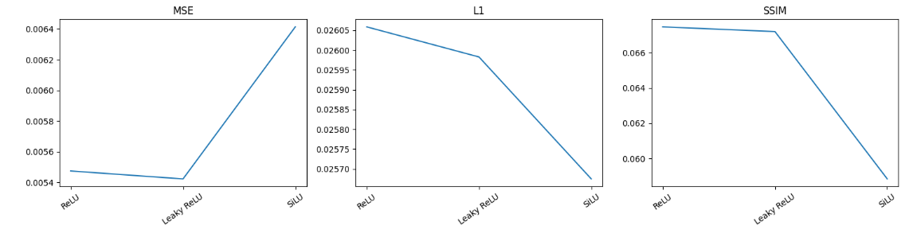
</p>

### Latent Activation Functions
<p align="center">
  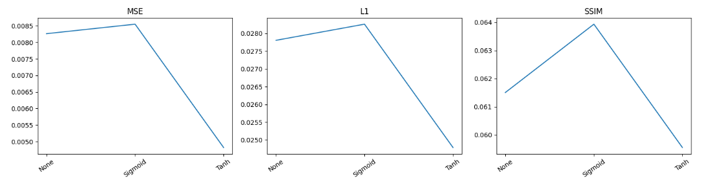
</p>

### Dropout Rate
The optimal dropout rate was **0.0**. Because `RandomAffine` data augmentation acts as a regularizer, adding dropout reduced overall reconstruction quality.

<p align="center">
  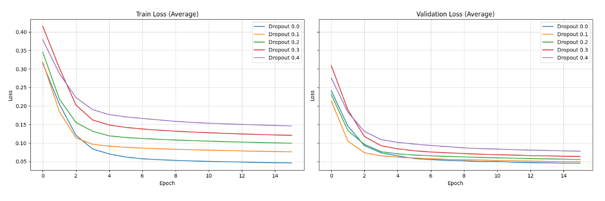
</p>

Dropout evaluation comparison:

<p align="center">
  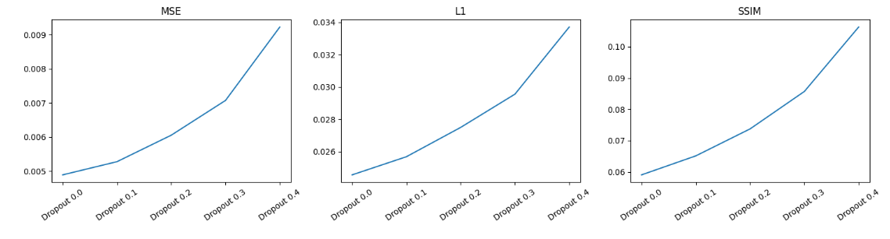
</p>

### Latent Dimension
A logarithmic scale was tested to find the optimal compression-to-quality ratio: `[2, 4, 8, 16, 32, 64]`. A dimension of **32** yielded the best trade-off—performing almost identically to 64 while substantially outperforming 16 and maintaining a low parameter count.

### Loss Function
The following reconstruction loss functions were benchmarked:
- MSE
- L1
- SSIM
- SSIM + L1

The combination of **SSIM + L1 Loss** yielded the best performance by balancing structural similarity (SSIM) with pixel precision (L1). The optimal configuration used $\alpha = 0.4$ ($0.4 \times \text{L1} + 0.6 \times \text{SSIM}$).

<p align="center">
  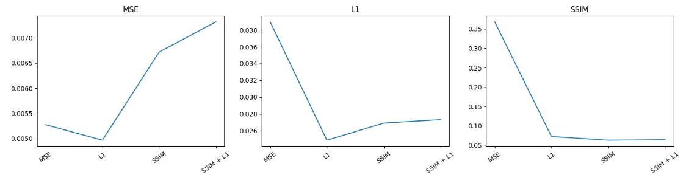
</p>

### Optimal Configuration

```python
{
    "id": "Optimal",
    "act_function": nn.SiLU,
    "latent_act_function": nn.Tanh,
    "dropout_rate": 0.0,
    "latent_dim": 32,
    "loss_function": SSIML1Loss(alpha=0.4),
    "epochs": 19
}
```

- **Original image size:** $28 \times 28 = 784$
- **Latent vector size:** 32
- **Compression ratio:** $\frac{784}{32} = 24.5
- **Dimensionality reduction:** $\left(1 - \frac{32}{784}\right) \times 100 \approx 95.92\%$

#### Reconstruction Results
Reconstructed images generated by the optimal configuration:

<p align="center">
  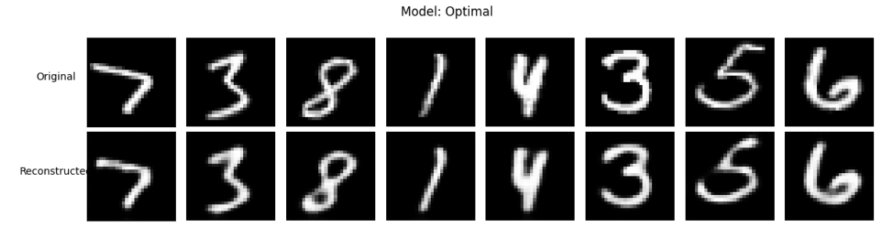
</p>

#### Latent Space Projection
UMAP projection of the learned latent space:

<p align="center">
  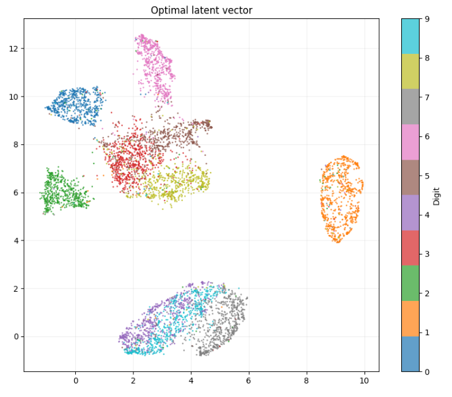
</p>

---

## Sparse Autoencoder (SAE)

Unlike compression autoencoders, a Sparse Autoencoder (SAE) projects information into a higher-dimensional latent space to extract disentangled, interpretable features. 

To prevent inactive/dead neurons (a common issue in sparse architectures), a fraction $t$ of the dense reconstruction loss is added to the sparse loss:

```python
loss = criterion(reconstructed_topk, images) + t * criterion(reconstructed_dense, images)
```

### Fixed Parameters
The following configurations were retained from previous experiments:

```python
{
    "act_function": nn.SiLU,
    "dropout_rate": 0.0,
    "loss_function": SSIML1Loss(alpha=0.4),
    "epochs": 19
}
```

### Latent Activation Function
To enforce strict sparsity, `nn.ReLU` is used as the latent activation function, turning off negative activation values.

### Top-k Sparsity & Latent Dimension
Sparsity is enforced using **Top-k + ReLU**. While L1 regularization was tested, it suppressed activations uniformly rather than forcing structured sparsity. Top-k provides precise control over feature selection and enforces strong sparsity.

Top-k retains only the $k$ largest activation values per sample while setting the rest to zero. However, this approach can lead to **dead neurons** (neurons whose gradients remain zero).

- **Objective ($k$):** Keep $k$ as low as possible to force sparsity and feature disentanglement.
- **Objective (Dimension):** Keep dimension high to extract fine-grained characteristics.
- **Constraints:** Setting $k$ too low degrades reconstruction quality and drastically increases dead neurons if unaligned with the latent dimension. Higher dimensions reach a point of diminishing returns where features become overly abstract.

#### Wide Spectrum Exploration
Initial evaluation across broader latent dimensions ($1024$ – $4096$) and $k$ values ($16$ – $64$):

<p align="center">
  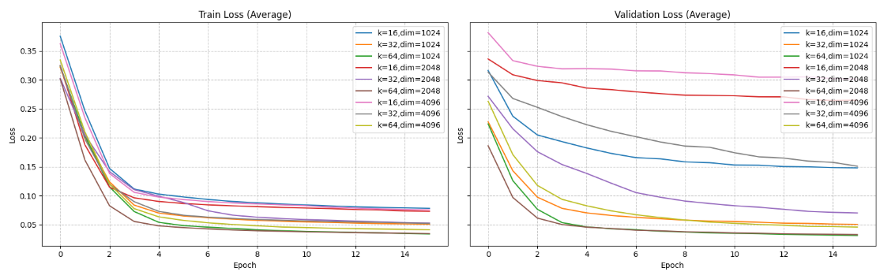
  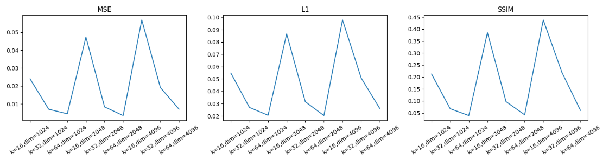
</p>

**Key Observations:**
- $k=16$ and dimension $4096$ can be safely discarded. The augmented MNIST dataset requires a minimum of 32–64 active features for accurate reconstruction.
- Latent dimension $2048$ represents the peak of feature extraction efficiency. Increasing dimensions beyond this degraded performance because features became too fine-grained, increasing the required number of active neurons per sample.

#### Refined Experiments
Focused sweeps on the most promising parameter ranges ($1024$ – $2048$):

<p align="center">
  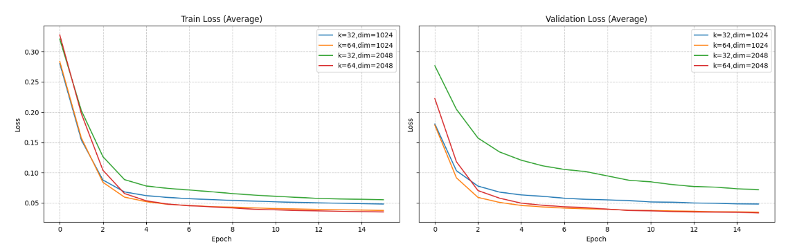
  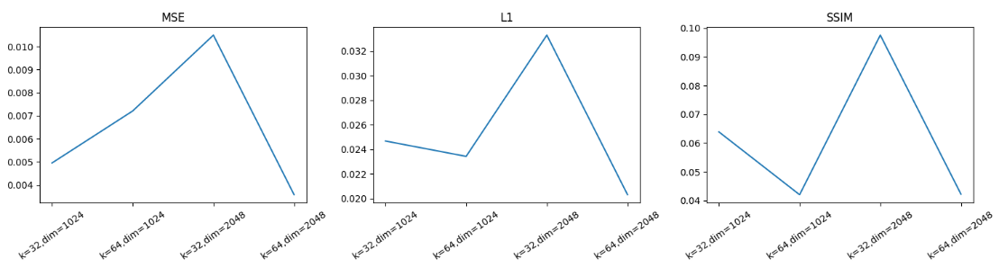
</p>

<p align="center">
  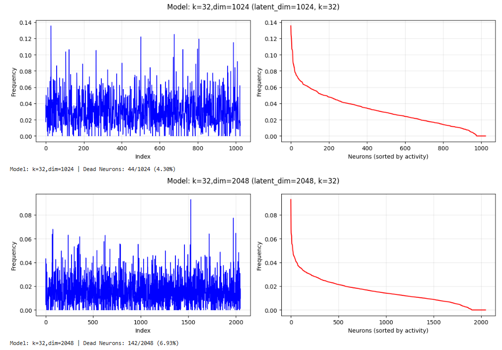
  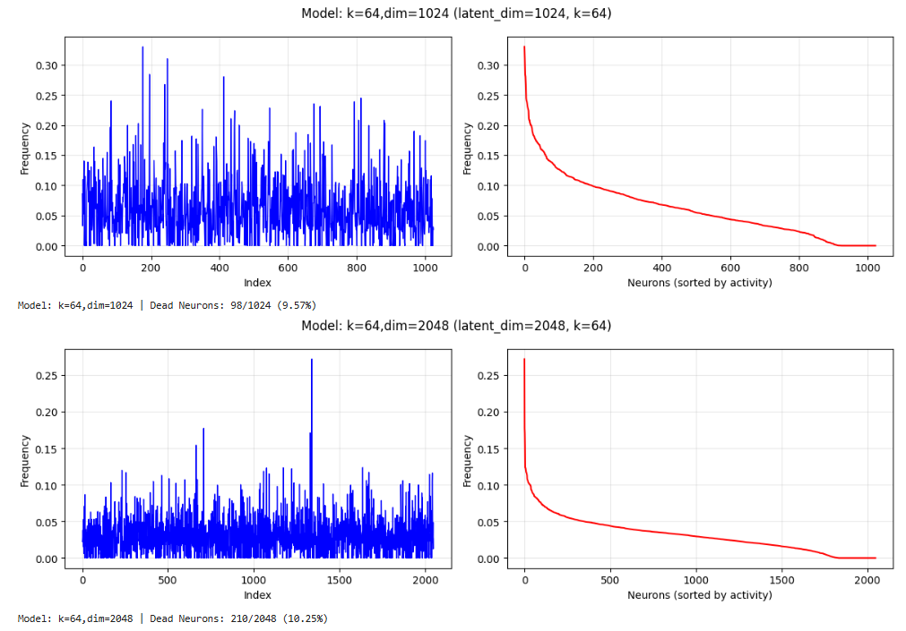
</p>

A typical dead neuron rate in SAEs ranges between 4–6%. The combination `{k=32, latent_dim=1024}` achieved low reconstruction loss while keeping dead neuron counts within acceptable limits.

### Dead Neurons & Auxiliary Loss Weight ($t$)
To control the dead neuron rate, different values for parameter $t \in [0.05, 0.10, 0.15, 0.20]$ were evaluated:

<p align="center">
  <b>t = 0.05</b><br>
  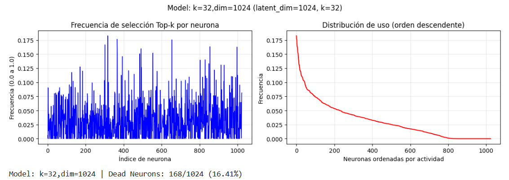
</p>

<p align="center">
  <b>t = 0.10</b><br>
  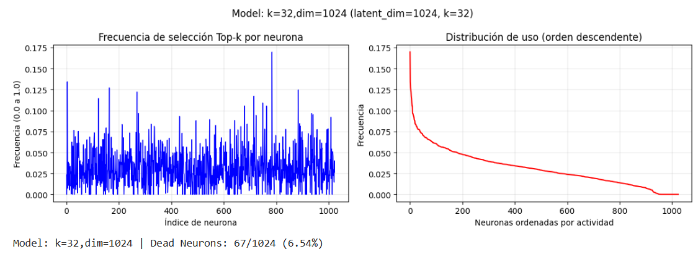
</p>

<p align="center">
  <b>t = 0.15</b><br>
  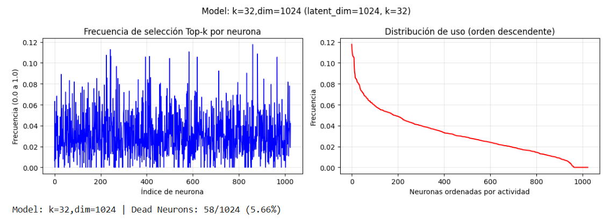
</p>

<p align="center">
  <b>t = 0.20</b><br>
  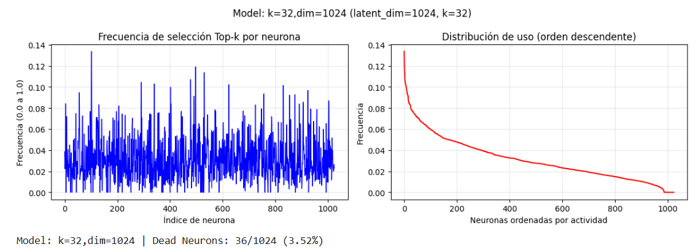
</p>

`t = 0.15` maintained the optimal balance between dead neuron mitigation (3–6%) and reconstruction accuracy. Values of $t \ge 0.20$ reduced dead neurons further but noticeably degraded reconstruction quality.

### Optimal Configuration

```python
{
    "id": "k=32,dim=1024",
    "act_function": nn.SiLU,
    "latent_act_function": nn.ReLU,
    "dropout_rate": 0.0,
    "latent_dim": 1024,
    "loss_function": SSIML1Loss(alpha=0.4),
    "k": 32,
    "epochs": 19
}
```

#### Reconstruction Results
Reconstructed images generated by the optimal SAE setup:

<p align="center">
  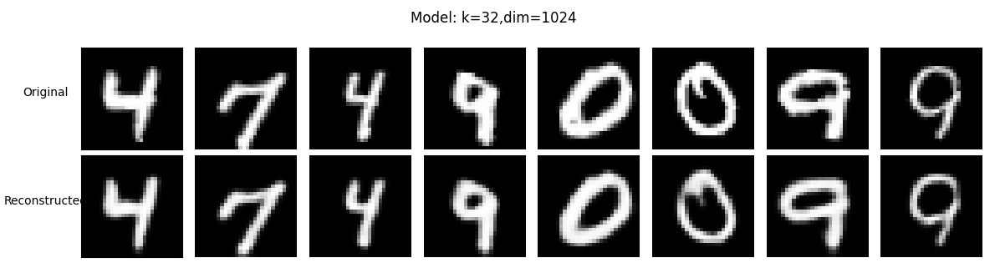
</p>

#### Latent Space Projections
The latent space was evaluated using two UMAP distance metrics:

- **Euclidean Distance (Sparse):** Sensitive to zero activations. Vectors sharing fewer active dimensions are projected farther apart, making it effective for identifying specific sub-clusters and stylistic variations within digits.
- **Cosine Distance (Compact):** Less sensitive to sparsity. Focuses on overall structural orientation, making high-level digit concepts easily separable despite intra-class feature variations.

<p align="center">
  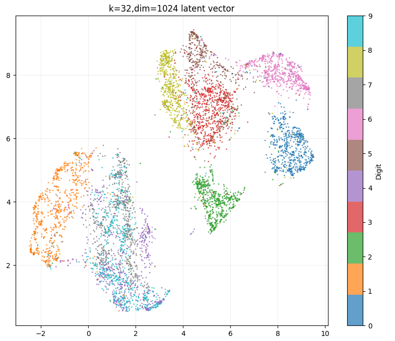
  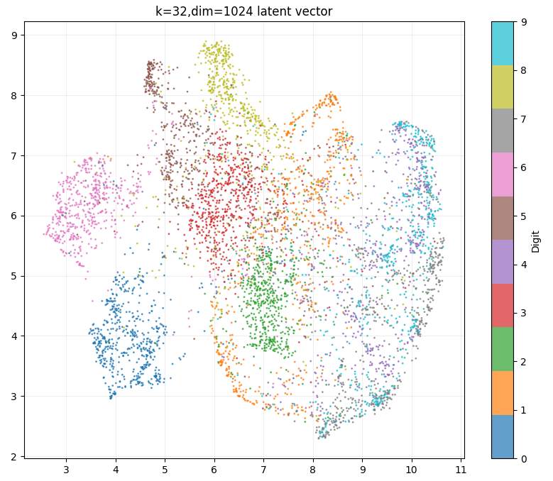
</p>
